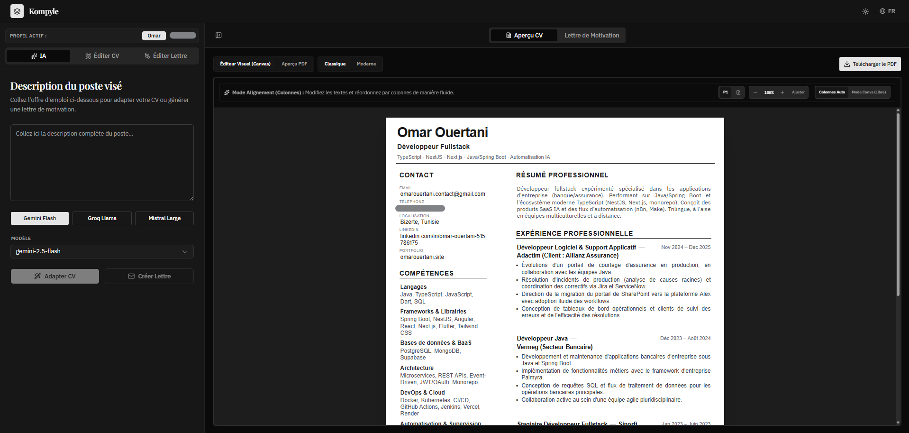
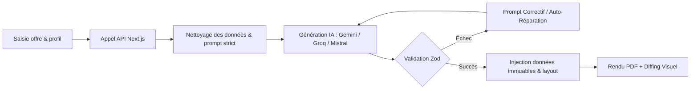

<div align="center">
  <a href="#">
    
  </a>

  <h1>🚀 Kompyle</h1>

  <p><b>Kompyle</b> est un adaptateur de CV intelligent et un éditeur interactif open-source basé sur l'IA qui simplifie l'adaptation en temps réel de vos candidatures aux offres d'emploi.</p>

  <p>
    <a href="#-démarrage-rapide-installation-locale"><b>Démarrer l'application</b></a>
    ·
    <a href="#⚙️-comment-fonctionne-lapplication-"><b>En savoir plus</b></a>
  </p>

  <p>
    
    
    
    
    
    
    
    
  </p>
</div>

---

**Kompyle** rend la personnalisation des candidatures extrêmement simple. Collez la description du poste visé, laissez l'IA reformuler vos expériences, ajustez visuellement la mise en page de votre CV sur un canvas interactif, et exportez le tout instantanément au format PDF de haute résolution.

Construit sur des principes de rigueur et d'absence totale d'hallucinations, Kompyle sépare la mise en page (layout) de la couche de données pour offrir un contrôle absolu à l'utilisateur, tout en s'appuyant sur des schémas de validation stricts.

---

## 📖 Table des Matières

1. [✨ Fonctionnalités](#-fonctionnalités)
2. [⚙️ Comment fonctionne l'application ?](#️-comment-fonctionne-lapplication-)
3. [🛠️ Stack Technique](#️-stack-technique)
4. [📁 Structure du Projet](#-structure-du-projet)
5. [🔑 Configuration des APIs & Environnement](#-configuration-des-apis--environnement)
6. [💿 Démarrage Rapide (Installation Locale)](#-démarrage-rapide-installation-locale)
7. [🐳 Déploiement avec Docker](#-déploiement-avec-docker)
8. [📄 Licence](#-licence)

---

## ✨ Fonctionnalités

**Adaptation par IA (CV & Lettre)**

- **Reformulation Intelligente** : Réécriture du résumé, réorganisation des compétences et reformulation ciblée des accomplissements d'expérience en fonction du poste visé.
- **Générateur de Lettre de Motivation** : Rédaction en un clic d'une lettre de motivation sur-mesure de 4 paragraphes en adéquation totale avec l'offre.
- **Zod Schema & Self-Healing** : Validation stricte des données générées par l'IA via un schéma Zod, avec mécanisme d'auto-correction en cas de JSON non conforme.
- **Anti-Hallucination** : Préservation absolue des coordonnées, établissements de formation et dates d'emploi réels. L'IA n'invente jamais rien.

**Éditeur Interactif & Layout (Canvas)**

- **Visualisation Côte-à-Côte** : Comparez votre CV d'origine et la version adaptée avec mise en valeur des différences (Text Diffing vert/rouge).
- **Glisser-Déposer (Drag & Drop)** : Réorganisez l'ordre des sections et déplacez-les entre les colonnes principale et latérale (via `@dnd-kit`).
- **Ajustement Dynamique des Marges** : Modifiez l'espacement entre les sections par glissement vertical à la souris.
- **Édition Directe (Canvas-style)** : Double-cliquez pour corriger ou enrichir le texte à la volée.

**Modèles & Internationalisation**

- **A4 Strict** : Prévisualisation des pages avec délimitation de saut de page pour une mise en page soignée.
- **Multi-langues** : Détection automatique de la langue de l'offre (FR/EN) et traduction de l'interface via `next-intl`.
- **Export PDF Haute Définition** : Rendu vectoriel via `@react-pdf/renderer` avec nommage professionnel de fichier.

---

## ⚙️ Comment fonctionne l'application ?

Kompyle utilise une architecture robuste en couches pour garantir la validité des CV :



1. **Extraction JSON** : L'IA reçoit uniquement la description textuelle du CV d'origine et l'offre d'emploi. Les données graphiques et d'espacement sont temporairement supprimées pour économiser la bande passante.
2. **Auto-Correction (Self-Healing)** : Si la structure JSON est altérée par l'IA, le serveur récupère les détails d'erreurs Zod et demande un correctif ciblé au modèle.
3. **Protection des Données (Immutabilité)** : Toutes les données clés réelles (emails, téléphones, universités, entreprises, dates de contrat) sont fusionnées de force sur les données adaptées pour neutraliser les hallucinations d'IA.
4. **Calcul de Différences** : L'éditeur affiche en surbrillance verte les ajouts de mots-clés et en rouge les anciens textes supprimés.

---

## 🛠️ Stack Technique

- **Framework** : Next.js 16.2.7 (App Router, routing multilingue, builds `standalone`)
- **React Engine** : React 19.2.4 (React Compiler activé pour de meilleures performances de rendu)
- **Styling** : Tailwind CSS v4.0 (variables CSS natives, PostCSS)
- **Validation** : Zod (validation de schéma et synchronisation automatique de type TypeScript)
- **PDF Engine** : `@react-pdf/renderer` (rendu asynchrone et vectoriel sécurisé)
- **Drag & Drop** : `@dnd-kit/core` & `@dnd-kit/sortable`
- **Diff Engine** : `diff` (calculateur de différences textuelles en temps réel)
- **i18n** : `next-intl` (Français / Anglais)

---

## 📁 Structure du Projet

```text
├── messages/               # Traductions de l'application (en.json, fr.json)
├── public/                 # Assets statiques et polices personnalisées
│   └── images/             # Captures d'écran de l'application (Kompyle1.png, kompyle2.png)
├── src/
│   ├── app/
│   │   ├── [locale]/       # Pages internationalisées et dashboard principal
│   │   └── api/            # Routeurs d'API (/api/adapt-cv, /api/generate-cover-letter)
│   ├── components/
│   │   ├── cv/             # Composants de gestion de CV, Canvas, éditeurs et popups
│   │   ├── pdf-primitives/ # Définitions de rendu de blocs PDF
│   │   └── ui/             # Composants réutilisables issus de shadcn/ui
│   ├── data/               # Données de CV de test (Omar, Chaima)
│   ├── schemas/            # Schémas de validation Zod du CV
│   ├── types/              # Déclarations des types TypeScript
│   └── utils/              # Aides à l'extraction JSON et configuration des polices
├── Dockerfile              # Dockerfile de production multi-stage
└── docker-compose.yml       # Déploiement simplifié des conteneurs
```

---

## 🔑 Configuration des APIs & Environnement

Pour connecter l'IA, créez un fichier `.env.local` à la racine de votre projet et ajoutez-y vos clés :

```env
# ─── Configuration des Clés d'API IA ──────────────────────────────────────────
# Renseignez au moins une clé. L'application possède un système de fallback 
# qui tente d'autres modèles si le premier échoue.

# 1. Google Gemini (Recommandé - Modèle par défaut : gemini-2.5-flash)
# Clé gratuite sur : https://aistudio.google.com/
GEMINI_API_KEY=votre_cle_gemini

# 2. Groq (Modèle par défaut : llama-3.3-70b-versatile)
# Clé sur : https://console.groq.com/
GROQ_API_KEY=votre_cle_groq

# 3. Mistral AI (Modèle par défaut : mistral-large-2512)
# Clé sur : https://console.mistral.ai/
MISTRAL_API_KEY=votre_cle_mistral
MISTRAL_MODEL=mistral-large-2512
```

---

## 💿 Démarrage Rapide (Installation Locale)

### 1. Installation des Dépendances
Installez d'abord les dépendances avec Node.js (version 20+ recommandée) :

```bash
npm install
```

### 2. Démarrage du Serveur de Développement
Exécutez l'application en mode développement :

```bash
npm run dev
```

Ouvrez ensuite [http://localhost:3000](http://localhost:3000) dans votre navigateur.

### 3. Build de Production
Générez le bundle optimisé pour la production :

```bash
npm run build
npm run start
```

---

## 🐳 Déploiement avec Docker

### Déploiement Facile (Docker Compose)
1. Renseignez vos clés API dans un fichier `.env` à la racine :
   ```env
   GEMINI_API_KEY=votre_cle_gemini
   GROQ_API_KEY=votre_cle_groq
   ```
2. Démarrez l'application :
   ```bash
   docker-compose up -d --build
   ```
L'application sera compilée puis disponible sur le port 3000 ([http://localhost:3000](http://localhost:3000)).

### Build Manuel avec Docker CLI
```bash
# 1. Compilation
docker build -t kompyle-app .

# 2. Démarrage
docker run -p 3000:3000 \
  -e GEMINI_API_KEY="votre_cle_gemini" \
  -e GROQ_API_KEY="votre_cle_groq" \
  kompyle-app
```

---

## 📄 Licence

Ce projet est sous licence MIT. Pour plus de détails, veuillez consulter le fichier [LICENSE](file:///c:/Users/oouer/Projects/Kompyle/LICENSE) à la racine du projet.
