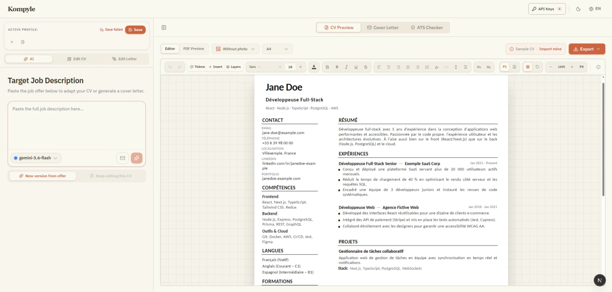
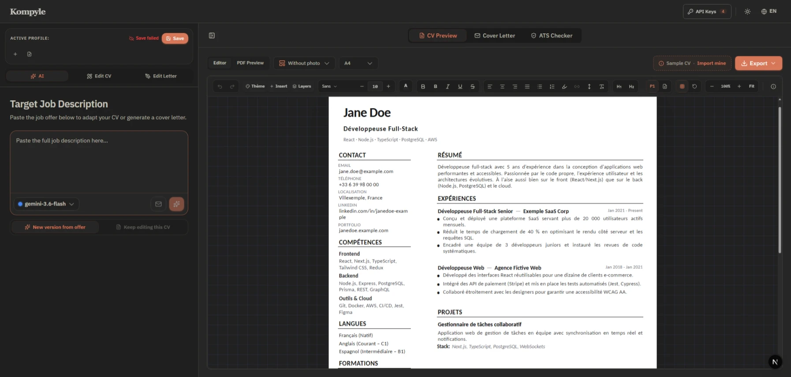
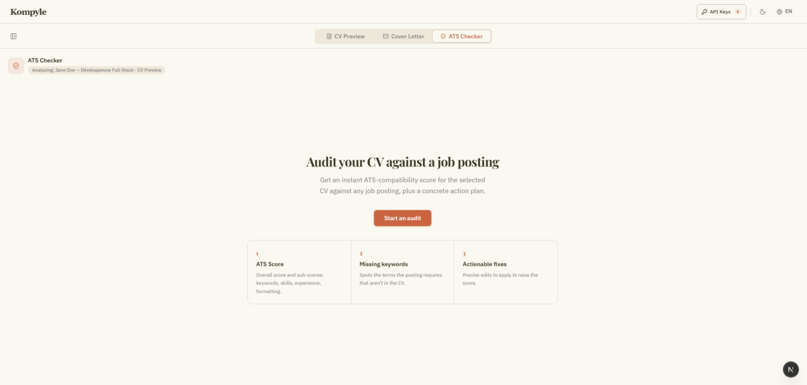
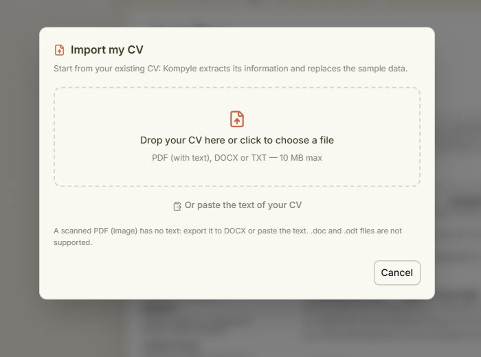
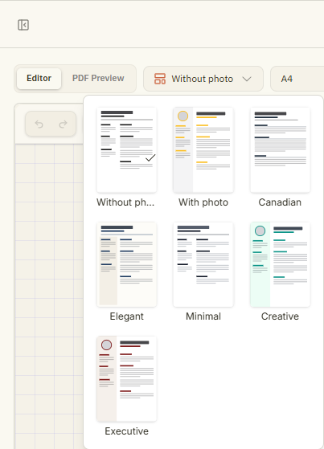
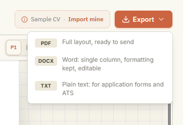

<div align="center">
  

  <p><b>An open-source, privacy-first CV editor with a drag-and-drop canvas, AI you bring yourself, and a built-in ATS checker.</b></p>

  <p>
    <a href="#quick-start-docker">Quick start</a> •
    <a href="#features">Features</a> •
    <a href="#screenshots">Screenshots</a> •
    <a href="#ai-providers-bring-your-own-key">AI providers</a> •
    <a href="#privacy">Privacy</a> •
    <a href="#local-development">Development</a> •
    <a href="#configuration">Configuration</a> •
    <a href="#contributing">Contributing</a>
  </p>

  <p>
    
    
    
    
    
  </p>
</div>

<p align="center">
  
</p>

**Kompyle** lets you build a CV the way you would in a design tool: every block sits on a canvas that maps one-to-one to the exported PDF. Import the CV you already have, tailor it to a job offer with the AI provider of your choice, check how an Applicant Tracking System (ATS) will read it, and export it as PDF, Word or plain text.

The app ships with a **fictional sample CV (Jane Doe)**, so you can try everything before entering any personal data.

---

## Quick start (Docker)

The only requirement is [Docker](https://docs.docker.com/get-docker/) with Compose. No account, no API key and no configuration file are needed.

```bash
git clone https://github.com/omarouertani/Kompyle.git
cd Kompyle
docker compose up --build
```

Then open **http://localhost:3000**.

`docker compose up` starts two containers:

| Service | Image | Role |
| --- | --- | --- |
| `app` | built from the [`Dockerfile`](Dockerfile) (Node 22, Next.js standalone output) | The web app on port `3000` |
| `db` | `postgres:16-alpine` | Stores your profiles in the `pgdata` volume; the schema ([`scripts/init.sql`](scripts/init.sql)) is created automatically on first start |

The app waits for the database to be healthy before starting. Your data survives restarts and rebuilds.

<details>
<summary><b>Useful commands</b></summary>

```bash
docker compose up --build -d                  # start in the background
docker compose logs -f app                    # follow the app logs
docker compose --profile seed run --rm seed   # optional: load the fictional "Jane Doe" profile
docker compose down                           # stop (your data is kept)
docker compose down -v                        # stop and DELETE the database volume
```

If port `3000` or `5432` is already taken, change it without editing any file:

```bash
APP_PORT=3100 DB_PORT=5433 docker compose up --build
```

</details>

> [!NOTE]
> Without a database the app still works: you can edit and export, but profiles are not saved. This is what happens if you run the app alone (`npm run dev` without PostgreSQL).

> [!TIP]
> The database password defaults to `kompyle_dev`, and PostgreSQL is only published on `127.0.0.1`. If you deploy Kompyle on a server, set your own `POSTGRES_PASSWORD` (see [Configuration](#configuration)) before the first `docker compose up`.

---

## Features

### Canvas editor
- **Free-form canvas**: drag, resize and align blocks with snapping guides, multi-select (lasso, <kbd>Shift</kbd>-click), zoom and pan. What you see is what the PDF contains.
- **Scale a whole selection**: change the text size of every selected block at once, or scale them by dragging a corner; blocks stay inside the page.
- **Sections by column**: the **Layers** panel lists the sections of each column and reorders them by drag and drop; the page re-lays itself out, keeping your per-block settings.
- **Rich text** (Tiptap): bold, italic, underline, lists, links, alignment, fonts and sizes, and a size setting per heading.
- **Skill levels**: in bar mode (Creative template), set a 1–5 level per skill by clicking the bar. The same bars appear in the PDF.
- **Undo / redo**, multi-page layout, **A4 or US Letter**, and an optional **profile photo** with a crop tool.
- **7 templates**: Without photo, With photo, Canadian, Elegant, Minimal, Creative and Executive, each with its own theme colors that you can adjust.
- **Light and dark** themes, and a **bilingual interface** (English / French).

### Import your existing CV
- Drop a **PDF** (with text), **DOCX** or **TXT** file, or paste the text.
- The text is extracted **in your browser**; it is only sent to the AI provider you selected, which structures it into the editor. The result is validated (Zod) and shown on a **review screen** before it replaces the sample data. You can cancel at any time, and the import can be undone with <kbd>Ctrl</kbd>+<kbd>Z</kbd>.
- Scanned PDFs (images) have no text: export them to DOCX, or paste the text.

### AI tailoring (bring your own key)
- **Adapt the CV to a job offer**: paste the offer, get a new version of your CV, and review the changes as a diff.
- **Refine** a CV or cover letter with free-form instructions.
- **Cover letters**: generate and edit a letter for each profile.
- **Anti-hallucination guardrails**: emails, phone numbers, dates, locations and skill levels are locked and re-imposed after the AI answers.

### ATS checker
- A score from 0 to 100 with sub-scores (keywords, skills, experience, formatting), the **missing keywords** found in the job posting, and a **concrete action plan**.

### Export
- **PDF**: vector PDF rendered on the server, identical to the canvas.
- **DOCX**: single column, formatting kept, editable in Word.
- **TXT**: plain text, handy for application forms and ATS portals.

### Profiles
- Keep several CVs, each with its own cover letter and one adapted version per job offer, stored in PostgreSQL.

---

## Screenshots

<table>
  <tr>
    <td width="50%"><br><sub><b>Editor</b>, dark theme</sub></td>
    <td width="50%"><br><sub><b>ATS checker</b>: audit a CV against a job posting</sub></td>
  </tr>
  <tr>
    <td width="50%"><br><sub><b>Import</b> a PDF, DOCX, TXT or pasted text</sub></td>
    <td width="50%"><br><sub><b>Templates</b></sub></td>
  </tr>
  <tr>
    <td width="50%"><br><sub><b>Export</b> to PDF, DOCX or TXT</sub></td>
    <td></td>
  </tr>
</table>

All screenshots use the built-in fictional sample data.

---

## AI providers (bring your own key)

Kompyle has **no AI account and no hidden quota**: you bring a key for the provider you prefer and enter it in the **API Keys** dialog of the app.

| Provider | Free tier | Get an API key |
| --- | --- | --- |
| Google Gemini | Yes (Flash / Flash-Lite models) | https://aistudio.google.com/apikey |
| Groq | Yes (rate-limited) | https://console.groq.com/keys |
| OpenRouter | Yes (`:free` models, daily limit) | https://openrouter.ai/keys |
| NVIDIA NIM | Yes (prototyping use) | https://build.nvidia.com/settings/api-keys |
| Anthropic Claude | No | https://platform.claude.com/settings/keys |
| OpenAI | No | https://platform.openai.com/api-keys |

Free tiers have rate and daily limits. When one is reached, Kompyle shows a clear message: wait for the reset or switch to another provider. Free models are tried in order within the same provider.

---

## Privacy

- **Your CV text is only sent to the AI provider you choose**, when you click an AI action (adapt, refine, import, cover letter, ATS check). Kompyle never sends it to another provider on its own, and there is no analytics or tracking.
- **File extraction is local**: PDF, DOCX and TXT files are read in your browser and are never uploaded as files.
- **API keys stay in your browser** (`localStorage`). They travel only in the request to Kompyle's own API routes, which forward them to the provider's official endpoint, and are never stored server-side.
- **Profiles are stored in your own PostgreSQL**: the one running next to the app in Docker, or yours.

To report a vulnerability, see [`SECURITY.md`](SECURITY.md).

---

## Local development

**Requirements:** [Node.js 22](https://nodejs.org/) (see `.nvmrc`) and npm. Docker is optional and only used for the database.

```bash
git clone https://github.com/omarouertani/Kompyle.git
cd Kompyle
npm install

docker compose up -d db     # optional: PostgreSQL on localhost:5432 (schema created automatically)
npm run db:seed             # optional: load the fictional "Jane Doe" profile
npm run dev                 # http://localhost:3000
```

Without PostgreSQL the app still starts: only saving profiles is unavailable.

### Scripts

| Script | Description |
| --- | --- |
| `npm run dev` | Development server with hot reload |
| `npm run build` | Production build (standalone output) |
| `npm run start` | Serve the production build |
| `npm run lint` | ESLint |
| `npm run db:up` / `db:down` | Start / stop the PostgreSQL container (`docker compose up -d db`) |
| `npm run db:seed` | Insert the fictional sample profile ([`scripts/seed_profiles.sql`](scripts/seed_profiles.sql)) |

Type-check with `npx tsc --noEmit`.

---

## Configuration

Everything has a working default: **no variable is required**. To change a value, copy the template and edit it:

```bash
cp .env.example .env
```

Docker Compose reads `.env` automatically; for `npm run dev`, use `.env.local` instead. See [`.env.example`](.env.example) for the full list.

| Variable | Default | Purpose |
| --- | --- | --- |
| `DATABASE_URL` | set by Docker Compose | PostgreSQL connection string (local development only) |
| `POSTGRES_PASSWORD` | `kompyle_dev` | Database password used by Docker Compose |
| `APP_PORT` / `DB_PORT` | `3000` / `5432` | Ports published on your machine |
| `NEXT_PUBLIC_SITE_URL` | `http://localhost:3000` | Public URL, for link-preview images |
| `OPENROUTER_API_KEY` | none | Optional server-side fallback key for OpenRouter |

There is no variable for the other AI providers: their keys are entered in the app.

---

## Architecture

```
src/
├─ app/
│  ├─ [locale]/            Pages (English / French) — the workspace
│  └─ api/                 Route handlers: adapt-cv, refine-cv, import-cv, ats-check,
│                          generate-cover-letter, refine-cover-letter, cv-profiles,
│                          render-pdf, render-docx
├─ components/
│  ├─ cv/                  Canvas editor, templates (PDF), import, ATS, cover letter
│  ├─ ai/                  Model picker
│  └─ ui/                  shadcn/ui primitives
├─ lib/                    Layout engine, AI providers and orchestration, CV import,
│                          skill levels, DOCX export, database access
├─ schemas/                Zod schemas for CV, cover letter and ATS results
└─ hooks/                  Profile manager, canvas interactions
messages/                  en.json / fr.json
scripts/                   init.sql (schema), seed_profiles.sql, seed.ts
```

The CV data and its layout are stored separately (JSON in PostgreSQL), so the same content can be laid out on any template. The PDF is rendered server-side with `@react-pdf/renderer` from the same layout the canvas shows.

| Layer | Technology |
| --- | --- |
| Framework | [Next.js 16](https://nextjs.org/) (App Router) and [React 19](https://react.dev/) |
| Language | TypeScript |
| UI | [Tailwind CSS v4](https://tailwindcss.com/), [shadcn/ui](https://ui.shadcn.com/), Radix UI and Base UI |
| Editor | [Tiptap](https://tiptap.dev/), [dnd-kit](https://dndkit.com/) |
| Export | [`@react-pdf/renderer`](https://react-pdf.org/) (PDF), [`docx`](https://docx.js.org/) (Word) |
| Import | [`unpdf`](https://github.com/unjs/unpdf) (PDF text), DOCX and TXT extraction in the browser |
| i18n | [`next-intl`](https://next-intl.dev/) |
| Database | [PostgreSQL](https://www.postgresql.org/) via `pg` |
| Validation | [Zod](https://zod.dev/) |

---

## Troubleshooting

- **The app starts but profiles cannot be saved** (a "Save failed" notice): PostgreSQL is not reachable. With Docker, check `docker compose ps` and `docker compose logs db`; in local development, start it with `docker compose up -d db`.
- **Port already in use**: `APP_PORT=3100 DB_PORT=5433 docker compose up --build`.
- **Start over with an empty database**: `docker compose down -v`, then `docker compose up --build`.
- **The schema changed after an update** (existing volume): the schema script only runs on an empty database; re-run it with `docker compose exec -T db psql -U kompyle -d kompyle < scripts/init.sql` (it is idempotent).

---

## Contributing

Contributions are welcome: bug reports, ideas and pull requests. Please read [`CONTRIBUTING.md`](CONTRIBUTING.md) first.

## License

Released under the [MIT License](LICENSE). Copyright (c) 2026 Omar Ouertani.
